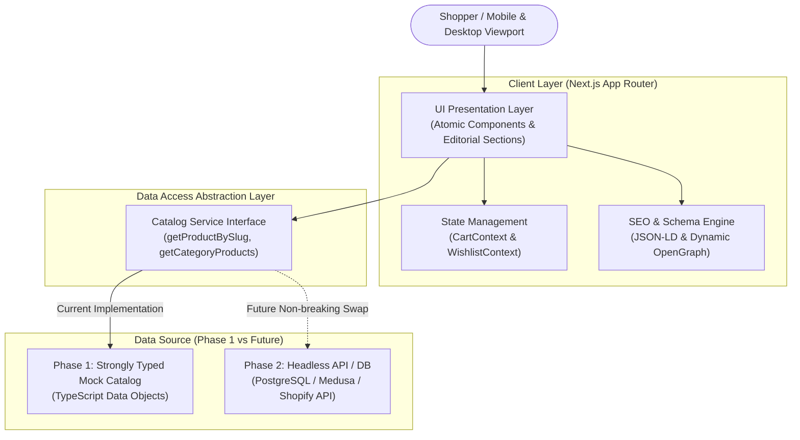

# System Architecture Specification — Kalyani Sarees Dhanpatganj

## 1. High-Level Architectural Overview

The **Kalyani Sarees Dhanpatganj** platform is engineered using modern modern Jamstack / Server-Side Rendering principles powered by **Next.js App Router**, **TypeScript**, and **Tailwind CSS**.

### Phase 1 System Topology
In Phase 1, the frontend operates autonomously without a database or backend server. All catalog data, category hierarchies, and store metadata are driven by strongly typed static repositories. Crucially, the UI communicates with these repositories via **abstract data-access interfaces** identical to future API client calls.

---

## 2. Core Architectural Pillars

1. **Separation of Concerns**: Presentation (`components/`) is completely insulated from storage mechanisms (`data/` or future APIs).
2. **Server-First Rendering**: App Router leverages React Server Components (RSC) for catalog indexing, static generation (SSG) of category/product pages, and zero-bundle-cost markdown parsing.
3. **Client Boundary Minimization**: `"use client"` is isolated strictly to interactive leaves (Cart Drawer, Filter Sheet, Accordion, Image Carousel, Wishlist Button).
4. **Resilient Local State**: Cart and wishlist persist locally via browser `localStorage`, ensuring a seamless shopping journey even before user authentication is introduced.

---

## 3. Technology Stack Specification

| Component | Technology | Rationale |
|---|---|---|
| **Framework** | Next.js 15+ (App Router) | Industry standard for ecommerce SEO, performance, hybrid SSG/ISR/SSR. |
| **Language** | TypeScript 5+ (Strict Mode) | Strong type contracts prevent runtime errors and streamline future backend typing. |
| **Styling** | Tailwind CSS v4 | Rapid design token consumption, zero runtime CSS bloat, and full responsive utility. |
| **Icons** | Lucide React | Clean, tree-shakable feather-style icons. |
| **Image Optimization**| Next.js Image (`next/image`) | Automatic AVIF/WebP conversion, responsive `srcset`, and layout shift prevention. |
| **Typography Engine** | `next/font/google` | Zero layout shift, self-hosted webfonts (`Playfair Display`, `Plus Jakarta Sans`). |

---

## 4. Scalability & Extensibility Roadmap

The system is architected to scale across three planned evolutionary stages:

1. **Phase 1 (Current)**: High-performance, SEO-optimized frontend catalog with client-side cart drawer, local storage persistence, responsive UI, and verified Dhanpatganj store presence.
2. **Phase 2 (Commerce Core)**: Integration of headless backend API, payment gateways (Razorpay / Cashfree / PhonePe for Indian Rupee UPI and cards), SMS/WhatsApp order confirmations, and customer account dashboard.
3. **Phase 3 (Omnichannel & Admin)**: Physical store POS inventory synchronization, local pickup in Dhanpatganj store, and administrative stock management.
