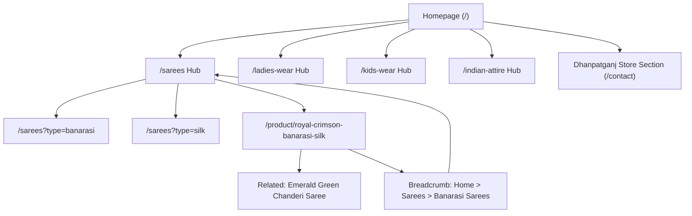

# SEO Strategy Specification — Kalyani Sarees Dhanpatganj

## 1. Organic Search Objectives

The search engine optimization strategy for **Kalyani Sarees Dhanpatganj** addresses two concurrent organic search vectors:
1. **Category & Product Authority**: Ranking for high-intent Indian ethnic fashion search queries across regional and national shoppers (e.g. "Pure Banarasi Silk Sarees", "Wedding Saree Collection", "Designer Kurti Sets").
2. **Local & Regional Commercial Intent**: Dominating hyper-local searches centered around Dhanpatganj, Sultanpur District, and surrounding towns in Eastern Uttar Pradesh.

---

## 2. Metadata Architecture & Tag Taxonomy

Every route in the Next.js App Router enforces a standardized metadata pattern via Next.js `Metadata` API:

```typescript
// Shared Metadata Formula
// Title Template: [Specific Page / Product Name] | [Category / Keyword Context] | Kalyani Sarees Dhanpatganj
```

### Metadata Matrix

| Page / Route | Title Tag Formula | Target Meta Description Length & Content | Target Primary Keywords |
|---|---|---|---|
| **Homepage (`/`)** | `Kalyani Sarees Dhanpatganj | Premium Indian Ethnic Wear & Sarees` | 150–158 chars: "Discover timeless Indian elegance at Kalyani Sarees Dhanpatganj. Explore authentic Banarasi silk sarees, designer kurtis, and kids' ethnic wear for every festive moment." | Kalyani Sarees Dhanpatganj, saree shop Dhanpatganj, Indian ethnic wear |
| **Sarees (`/sarees`)** | `Pure Silk & Designer Sarees | Kalyani Sarees Dhanpatganj` | 150–158 chars: "Shop handcrafted Banarasi, Kanjivaram, Chanderi, and festive sarees at Kalyani Sarees Dhanpatganj. Perfect for weddings, pujas, and celebrations." | pure silk sarees, banarasi sarees Dhanpatganj, wedding sarees |
| **Ladies Wear (`/ladies-wear`)** | `Ladies Ethnic Wear & Designer Suit Sets | Kalyani Sarees Dhanpatganj` | 150–158 chars: "Elevate your festive wardrobe with embroidered suit sets, elegant anarkalis, kurtis, and festive lehengas from Kalyani Sarees Dhanpatganj." | ladies wear Dhanpatganj, designer kurtis, ethnic suit sets |
| **Kids Wear (`/kids-wear`)** | `Kids Ethnic Wear & Festive Outfits | Kalyani Sarees Dhanpatganj` | 150–158 chars: "Traditional Indian clothing for boys and girls. Shop festive kurta pyjamas, lehengas, and celebration outfits at Kalyani Sarees Dhanpatganj." | kids ethnic wear, boys kurta pajama Dhanpatganj, girls lehenga |
| **Indian Attire (`/indian-attire`)** | `Traditional Indian Attire & Festive Outfits | Kalyani Sarees Dhanpatganj` | 150–158 chars: "Curated Indian traditional and wedding wear for every auspicious celebration. Premium ethnic fashion from Kalyani Sarees Dhanpatganj." | Indian attire, festive wear Dhanpatganj, traditional clothing |
| **Product Detail (`/product/[slug]`)** | `[Product Name] - [Fabric] | Kalyani Sarees Dhanpatganj` | Dynamic: Includes weave, fabric, occasion, and delivery assurance. Max 155 chars. | [Product Name], [Fabric] saree online |

---

## 3. Internal Linking Architecture

Search engine crawlers rely on logical, interconnected link structures to distribute PageRank and establish topical authority:



### Core Linking Rules
1. **Breadcrumb Sequence**: Every product page links directly up to its primary category hub and sub-category.
2. **Contextual Cross-Selling**: Saree product pages link to matching unstitched blouse fabrics and accessories.
3. **Local Anchors**: The global footer, about page, and contact page link with natural localized anchor text: *"Visit our flagship retail showroom in Dhanpatganj"*.

---

## 4. Image SEO Strategy

Because ethnic fashion is highly visual, Google Images is a primary customer acquisition funnel:
- **File Naming Convention**: Descriptive hyphenated names containing fabric, color, and brand:
  - Good: `royal-maroon-pure-banarasi-katan-silk-saree-kalyani-sarees.webp`
  - Bad: `IMG_20261003_9482.jpg`
- **Alt Text Formula**:
  - `[Product Name] in [Color] made of [Fabric Type] - Kalyani Sarees Dhanpatganj`
  - Example: *"Crimson Red Banarasi Katan Silk Saree with Antique Gold Zari border - Kalyani Sarees Dhanpatganj"*
- **Next.js Image Attributes**: Explicit `width`, `height`, and `sizes` to eliminate CLS and enable instant mobile decoding.

---

## 5. Technical SEO: Canonical URLs, Sitemaps & Robots

### 5.1 Canonical Tags
- All filtered views (e.g. `/shop?color=maroon&price=5000`) canonicalize back to the pure static category URL `/shop` or `/sarees` to prevent duplicate content dilution.

### 5.2 Dynamic Sitemap Generation (`src/app/sitemap.ts`)
- Automatically outputs indexable URLs with `<lastmod>` timestamps and appropriate `<changefreq>`:
  - Homepage & Main Categories: `daily`, priority `1.0` to `0.9`
  - Product Detail Pages: `weekly`, priority `0.8`
  - Informational / Legal Pages: `monthly`, priority `0.4`

### 5.3 Robots Directives (`src/app/robots.ts`)
- Allows public indexing of all catalog, collection, and content pages.
- Disallows utility paths: `/cart`, `/checkout`, `/account`, `/search`.
